# Awesome Cloud Automated Test Execution Engine 🚀

  

  
  
  
  
  

---

## 🧭 Sector Overview & Market Dynamics

The global **automated testing market** is valued at approximately **$24B–$28B (2025–2026)**, projected to surpass **$80B+ by 2034** expanding at a ~15% CAGR, while the dedicated **cloud testing infrastructure market** accounts for roughly **$13B–$14B** growing at an 11%–13% CAGR. 

The sector displays a **moderately fragmented yet converging landscape**: while massive enterprise platforms (Microsoft, AWS, Tricentis, BrowserStack) capture disproportionate enterprise spend, deep developer specialization—ranging from Kubernetes-native headless clusters to framework-coupled orchestration engines (Cypress, Playwright)—continues to prevent a singular "winner-take-all" outcome.

---

## 📑 Table of Contents
- [✨ Overview](#-overview)
- [🧭 Sector Overview & Market Dynamics](#-sector-overview--market-dynamics)
- [☁️ SaaS & Hosted Platforms](#️-saas--hosted-platforms)
- [💻 Open-Source GitHub Projects](#-open-source-github-projects)
- [🏗️ Reference Architectures](#️-reference-architectures)
- [🤝 How to Contribute](#-how-to-contribute)
- [💖 Support & Sponsorship](#-support--sponsorship)
- [📈 Star History](#-star-history)
- [⚠️ Disclaimer](#️-disclaimer)

---

## ✨ Overview

Welcome to the definitive, SEO-optimized curated index of **Cloud Automated Test Execution Engines** and **Distributed Testing Infrastructure**. In modern DevOps and continuous integration (CI/CD) pipelines, automated testing bottlenecks are no longer caused by authoring scripts—they are caused by runtime execution throughput. 

Cloud test execution engines solve this by orchestrating massive, parallel test runs across ephemeral headless containers, cross-browser clouds, and physical mobile device grids with built-in flaky test detection, dynamic sharding, smart retries, and comprehensive telemetry.

---

## ☁️ SaaS & Hosted Platforms

The table below catalogs premier commercial test execution clouds and managed runners, sorted descending by parent company valuation / enterprise scale:

| Product | Company Size (Valuation / Revenue) | Description | Starting Pricing | Free Tier / Trial Limits |
| :--- | :--- | :--- | :--- | :--- |
| **[AWS Device Farm Runner](https://aws.amazon.com/device-farm/)** | **~$2.2 Trillion** market cap (Amazon parent) / AWS cloud division | Managed continuous mobile app & web testing service on physical iOS and Android devices, emulators, and browsers. | **$0.17 per device minute** (Pay-as-you-go); Unlimited slot plan from **$250/month per device slot** | **1,000 free device minutes** one-time trial on initial signup |
| **[GitHub Actions Runner](https://github.com/features/actions)** | **~$3.1 Trillion** market cap (Microsoft parent) / GitHub subsidiary | Native, scalable cloud CI/CD execution runner with dynamic matrix orchestration and hosted VM fleets. | Linux 2-core: **$0.006/minute**; Windows 2-core: **$0.010/minute**; macOS: **$0.062/minute** | **2,000 free minutes/month** for private repositories (unlimited free execution for public repos) |
| **[Microsoft Playwright Testing](https://playwright.dev/)** | **~$3.1 Trillion** market cap (Microsoft parent) | Fully managed cloud browser execution service engineered specifically for high-speed Playwright parallel suites. | Cloud runner: **$0.01 per test runner minute** (core framework is free & open-source) | **30-day free trial** with first 100 test minutes and 1,000 test results included |
| **[Tricentis Testim](https://www.testim.io/)** | **~$4.5 Billion** valuation / ~$425M ARR (GTCR & Insight Partners backed) | AI-orchestrated test execution platform utilizing dynamic ML locators and parallel cloud browser execution slots. | Baseline paid contracts start from **~$450–$500/month** (annual multi-slot enterprise licensing) | **Community Free Plan**: 1,000 test runs/month for 1 user seat; 7-day enterprise trial upon request |
| **[BrowserStack Automate](https://www.browserstack.com/)** | **~$4.0 Billion** valuation / ~$230M ARR (BOND & Insight Partners backed) | Enterprise cloud browser & mobile grid executing Selenium, Cypress, Playwright, and Appium on 3,000+ real environments. | Automate Desktop: **$99/month per parallel slot** (billed annually); Desktop & Mobile: **$175/month** | **No permanent free tier**; 14-day free trial with 100 automation minutes upon signup (free for qualifying OSS) |
| **[CircleCI Test Runner](https://circleci.com/)** | **~$1.7 Billion** valuation / ~$56M ARR | Distributed cloud CI/CD test runner with dynamic container parallelism, intelligent test splitting, and auto-rerun. | Performance Tier: **$15/month** base + consumption credits | **Free forever plan**: 30,000 build credits/month (~3,000 Linux medium minutes) with up to 5 users |
| **[Sauce Labs Test Runner](https://saucelabs.com/)** | **~$613 Million** valuation / ~$100M ARR (TPG & Riverwood Capital backed) | Cloud-based continuous testing pioneer offering Virtual Device Cloud (emulators/simulators) and physical Real Device Cloud. | Virtual Device Cloud: **$149/month** (billed annually); Real Device Cloud: **$199/month** | **No permanent free tier**; 28-day free trial with 100 automated testing minutes |
| **[LambdaTest HyperExecute](https://www.lambdatest.com/)** | **~$400 Million** valuation / ~$20M+ ARR (Avataar & Qualcomm backed) | AI-powered next-gen test orchestration engine delivering low-latency parallel execution across cross-cloud VM clusters. | HyperExecute Linux: **$103/month per parallel slot** (annual billing); Windows/macOS: **$159/month** | **Free forever plan**: 300 HyperExecute minutes + 2 concurrent sessions (10 free parallel slots for OSS) |
| **[Cypress Cloud](https://www.cypress.io/)** | **~$255 Million** valuation / ~$20M ARR (Battery & OpenView backed) | Managed orchestration layer providing dynamic test parallelization, smart load balancing, and flake detection for Cypress. | Team Tier starts at **$75/month**; Business Tier at **$300/month** (core test runner is MIT open source) | **Free forever plan**: 500 test results/month, 10 user seats, and 30-day retention (free OSS plan: 100k tests/mo) |
| **[Aerokube Moon (Cloud)](https://aerokube.com/moon/)** | **Bootstrapped / ~$1 Million** ARR (Privately held, Estonia) | Managed Kubernetes-based browser orchestration infrastructure supporting Selenium, Playwright, Puppeteer, and Cypress. | **$5 per parallel session per month** (billed per active concurrent browser pod) | **Free evaluation license** of any cluster size during pre-production migration |

---

## 💻 Open-Source GitHub Projects

For engineering teams seeking self-hosted, vendor-neutral, or Kubernetes-native test execution runners without per-parallel cloud surcharges, the following open-source projects represent the category leaders. Ranked strictly by GitHub stargazers:

| Project | GitHub_Stars | Description | Supported Frameworks |
| :--- | :--- | :--- | :--- |
| **[Kubernetes](https://github.com/kubernetes/kubernetes)** |  | Foundation orchestration platform for dynamic browser scaling, orchestrating ephemeral runner pods per test session. | Any / Containerized Pods |
| **[Playwright](https://github.com/microsoft/playwright)** |  | Microsoft's next-gen browser automation engine featuring native parallel execution, dynamic test sharding, and trace recording. | Chromium, Firefox, WebKit |
| **[Puppeteer](https://github.com/puppeteer/puppeteer)** |  | Google Chrome team's headless browser automation library enabling programmatic test execution and trace diagnostics. | Chromium, Chrome, Firefox |
| **[Cypress](https://github.com/cypress-io/cypress)** |  | Fast, reliable browser testing engine with real-time reload, time-travel debugging, and automatic element waiting. | Chromium, Firefox, Edge |
| **[Selenium](https://github.com/SeleniumHQ/selenium)** |  | W3C WebDriver standard implementation including Selenium Grid 4 for distributed hub-and-node test execution routing. | All WebDriver Browsers |
| **[k6](https://github.com/grafana/k6)** |  | Modern cloud-native load and performance test execution engine written in Go, featuring browser automation support. | JavaScript, Headless Web |
| **[Appium](https://github.com/appium/appium)** |  | Open-source ecosystem for orchestrating cross-platform native, hybrid, and mobile web test execution across physical devices. | iOS, Android, macOS, Windows |
| **[WebdriverIO](https://github.com/webdriverio/webdriverio)** |  | Next-gen browser and mobile automation test framework for Node.js with built-in test runner and cloud provider integrations. | WebDriver, Chrome DevTools |
| **[docker-selenium](https://github.com/SeleniumHQ/docker-selenium)** |  | Complete containerized Selenium Grid 4 solution providing turnkey hub and browser node Docker images for self-hosted execution. | Chrome, Firefox, Edge |
| **[Selenoid](https://github.com/aerokube/selenoid)** |  | High-performance Go daemon launching isolated browsers within ephemeral Docker containers per session (Archived Dec 2024). | Selenium WebDriver |
| **[Moon by Aerokube](https://github.com/aerokube/moon)** |  | Kubernetes and Openshift-native browser orchestration controller allocating ephemeral browser pods on demand (~3s cold boot). | Selenium, Playwright, Cypress |
| **[WebSummoner](https://github.com/WebSummoner/websummoner)** |  | Maintained community successor to Selenoid written in Go, orchestrating ephemeral Docker container browser sessions with zero Java. | Selenium, WebDriver |

---

## 🏗️ Reference Architectures

When constructing custom enterprise test infrastructure, teams commonly compose these patterns:

* **Container-Native Parallel Execution:** Pair **[Playwright](https://github.com/microsoft/playwright)** with **[Moon](https://github.com/aerokube/moon)** deployed onto **[Kubernetes](https://github.com/kubernetes/kubernetes)** to achieve on-demand sub-second pod spin-up and dynamic sharding across dozens of parallel workers.
* **Hybrid Cloud-On-Prem Grid:** Deploy **[docker-selenium](https://github.com/SeleniumHQ/docker-selenium)** on private servers for fast smoke passes, bursting to **[BrowserStack](https://www.browserstack.com/)** or **[Sauce Labs](https://saucelabs.com/)** for exhaustive device matrix verification.
* **Smart CI Orchestration:** Combine **[GitHub Actions](https://github.com/features/actions)** or **[CircleCI](https://circleci.com/)** with **[LambdaTest HyperExecute](https://www.lambdatest.com/)** or **[Cypress Cloud](https://www.cypress.io/)** for intelligent change-based test selection and automatic flake suppression.

---

## 🤝 How to Contribute

Contributions are welcome! Please follow these guidelines:

1. 🍴 Fork the repository.
2. 🌿 Create a new feature branch (`git checkout -b feature/add-new-engine`).
3. 📝 Add your entry ensuring:
   - For SaaS: Include starting pricing, free tier/trial boundaries, and company size.
   - For Open-Source: Include GitHub Stars_Badge formatted as ``.
4. 🚀 Submit a well-described Pull Request!

---

## 💖 Support & Sponsorship

If you find this curated collection useful for your QA architecture, DevOps pipelines, or testing infrastructure, please consider supporting the project:

- ⭐ **Star this repository** to help others discover it!
- 🍴 **Fork and contribute** new open-source and cloud testing tools!
- 📢 **Share with your team**, on LinkedIn, Twitter/X, and tech communities!
- ☕ **Buy me a coffee / Sponsor on GitHub:** [Sponsor Dashboard](https://github.com/sponsors/ishandutta2007)

Your support fuels continuous maintenance, benchmarking, and updates to the developer community! 🌟

---

## 📈 Star History

---

## ⚠️ Disclaimer

- This repository is a community-curated collection for educational and architectural evaluation purposes.
- Cloud test execution engines execute arbitrary browser and application code; always implement strict network segmentation, credential secret scrubbing, and automated container teardown.
- Pricing, free tiers, and company metrics are updated periodically based on public filings and vendor disclosures; verify up-to-date quotes directly with providers prior to procurement.
